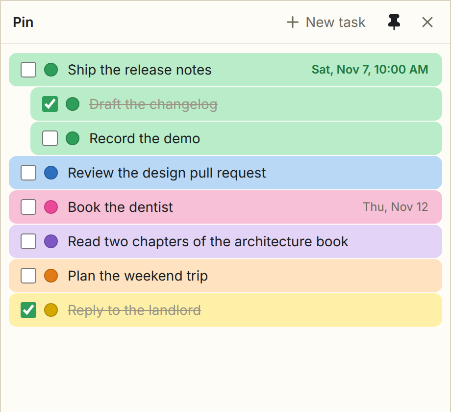

# Pin



Pin keeps your ranked priorities on top of every window. Each line is a task: drag it up or down, color it, give it
subtasks and a date. The list is a plain Markdown file, so any notes app can read and edit it too. Pin follows your
desktop's light or dark appearance.

## Install

- Snap: `sudo snap install pinned` (after the first store release)
- AppImage and `.deb`: from the GitHub release page

## Use

| Do | How |
|---|---|
| New task | **New task**, or Enter at the end of a task (Enter mid-text splits it) |
| Subtask | **+** on the row, Ctrl+T, or Tab (Shift+Tab lifts it back) |
| Delete | trash icon on the row, Ctrl+Shift+Backspace, or Backspace on an empty task |
| Date and time | Ctrl+D, or **⋯ → Add date** |
| Color | click the round dot: twelve colors or any custom color |
| Done | the checkbox, or Ctrl+Enter |
| Reorder | drag the handle, or Alt+↑ / Alt+↓ |
| Undo / redo | Ctrl+Z / Ctrl+Shift+Z or Ctrl+Y |
| Keep on top | the pin in the header: filled while Pin floats on top |

## The list file

Pin edits `Pin.md` in your Documents folder. A task line looks like
`- [ ] ==🟢Ship the release notes== 📅 2026-11-07 10:00`; two spaces of indent make a subtask.
The six named colors use the `==🟢…==` highlight markers; any other color is saved as
`<mark style="background: #ec4899;">…</mark>`.

## Sync across devices

Sync the list file with your dotfiles tool, Git, or another file-sync service. Pin does not run a sync service itself.
To put the list in a synced folder, add its path to `settings.json` on each device. For a native install:

```json
{ "file": "~/dotfiles/Pin.md" }
```

For a native install, the settings file is `~/.config/Pin/settings.json` (or `$XDG_CONFIG_HOME/Pin/settings.json`
if set). In Snap, it is `~/snap/pinned/current/.config/Pin/settings.json`. Create the folder and file if needed.
In Snap, use the absolute path to the real home directory, for example `/home/your-user/dotfiles/Pin.md`:
`~` there means Snap's private home. Snap's home interface allows non-hidden paths under your real home; a hidden
dotfiles directory or a symlink into one is not accessible.
The optional `PRIORITIES_FILE` environment variable takes precedence over this setting. Window bounds and folded
state are local; you only need to sync the list.

Pin detects disk changes while open. If you are editing or have unsaved changes, it pauses saving and asks whether
to use the disk version or overwrite it with yours. Copy any text you want to keep before choosing. Pin checks the
file before saving and replaces it atomically, but a change made in the instant between that check and replacement
can still collide. Keep Git history or another backup for simultaneous edits across devices.

## Build

```sh
npm ci
npm run build && npm start
npm test                 # file round trip and safe saves
npm run dist             # Snap, AppImage and .deb into release/
```

MIT licence. Icons: [Lucide](https://lucide.dev) (ISC); see `THIRD_PARTY_NOTICES.md`.
